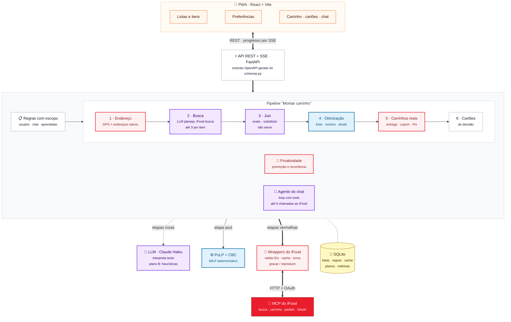

# Cesta: documento técnico resumido

Hackathon SEMCOMP × iFood 2026, entregável 05: arquitetura, uso do MCP e decisões técnicas principais. Detalhes de cada etapa estão em `busca-e-otimizacao.md`, a proatividade em `proatividade.md` e as dores do MCP em `mcp-feedback.md`.

## O que o sistema faz

O usuário mantém listas de compras de mercado ("2 leite italac integral", "500g café moído") e preferências (marcas em ordem, marcas bloqueadas, variedades, frete máximo, quantidade exata). Ao tocar em "Montar carrinho", o back-end busca os produtos no iFood, escolhe o que comprar e em quais mercados, monta os carrinhos de verdade e mostra o **total real**, já com frete, taxa e o melhor cupom. Depois do carrinho pronto, o chat é um agente com tools: ele consulta o iFood e mexe no carrinho real a pedido do usuário ("tem leite sem lactose no Extra?", "troca o café por um mais forte"), e uma preferência dita na conversa vira regra salva.

## Arquitetura

Cores: roxo usa o LLM, azul usa o solver, vermelho chama o iFood. Imagem para slides em `arquitetura.png`.

O princípio que guia a divisão é: **LLM onde há linguagem ambígua, código onde há regra, conta e custo.**

- **Pipeline determinístico, agente só no chat.** Para montar o carrinho, o LLM nunca chama uma tool do iFood: ele devolve JSON validado por esquema, e o back-end decide e chama. Assim a mesma lista gera o mesmo carrinho e o número de chamadas é controlado. O único loop agêntico é o chat sobre o carrinho pronto, onde os pedidos são abertos por natureza (seção "Agente do chat").
- **O LLM interpreta.** Transforma o texto do item em buscas, julga se cada produto serve para o pedido, extrai marca e tamanho do nome, converte mensagens do chat em regras e responde perguntas sobre o carrinho.
- **O solver decide.** A escolha de produtos e mercados é um problema combinatório (frete por mercado, pedido mínimo, dividir ou não a compra), resolvido por programação linear inteira. A mesma lista com as mesmas preferências gera o mesmo carrinho.
- **O iFood dá o preço final.** Cupom, taxa de serviço e frete só existem no carrinho, então o total mostrado vem do carrinho real.

## Pipeline "Criar carrinho"

| Etapa | O que faz | Tools do MCP |
|---|---|---|
| 1. Endereço | GPS do navegador cruzado com os endereços salvos (até 200 m, ou a margem do GPS) | `listAddresses` (sempre a primeira); `createAddress` em duas etapas se nenhum servir |
| 2. Busca, fase 1 | até 3 buscas por item, planejadas pelo LLM e guardadas no item | `searchOffers` (`resultKind: ITEM`, `merchantType: GROCERIES`, qualificadores em `refinements`) |
| 3. Mercados | até 5 candidatos por cobertura da lista, frete e pedido mínimo | `getMerchant` (pedido mínimo e métodos de entrega) |
| 4. Busca, fase 2 | lacunas (item sem resultado num dos 3 melhores mercados) e marcas preferidas | `searchOffers` com `refinements.merchantId` |
| 5. Juiz e normalização | o LLM classifica cada produto como exato, substituto ou não serve; marca e tamanho são extraídos do nome | nenhuma |
| 6. Otimização | MILP: preço × embalagens + frete + penalidades, com pedido mínimo e limite de mercados; uma rodada com 1 mercado e outra dividida, mais alternativas | nenhuma |
| 7. Carrinhos reais | até 3 soluções viram carrinho; entrega e horário, cupom, Pix; vence o menor total real | `createCart`, `getItem` (só se o produto exigir opções), `getCartDeliveryMethods`, `setCartDelivery`, `listVouchers`, `setVoucher`/`removeVoucher`, `listPaymentMethods`, `setCartPayment` |
| 8. Decisões | cartões para o que difere do pedido: substituto, marca fora da preferência, falta, compra dividida | nenhuma |
| 9. Pedido | confirmação, Pix e rastreio | `getCart`, `submitOrder`, `getOrder`, `trackOrder` (respeita `retryMessage`, para em `pollingStop`) |

Trocas feitas pelo cartão ou pelo agente do chat mexem no carrinho real (`addItemToCart`, `updateCartItem`, `removeItemFromCart`) e refazem a otimização em memória para avisar se dá para pagar menos. A proatividade usa `searchOffers` com `onlyWithPromotion` para sugerir adiantar ou estocar itens em promoção, e o primeiro login importa as compras anteriores de mercado com `getRecommendations` (`RECENT_ORDERS`) para o app não começar sem histórico.

O progresso de cada etapa chega ao front por SSE.

## Uso do MCP

**Cliente.** `app/mcp/client.py` fala com o MCP por HTTP com o SDK oficial `mcp` e OAuth próprio do back-end, com renovação pelo `refresh_token` antes de o token vencer. O usuário só faz login de novo se a renovação for recusada. Os formatos de erro do MCP (`errors`, `error`, `errorType` e `code`/`message` na raiz) são normalizados num tipo só, com a distinção entre erro passageiro e definitivo.

**Wrappers que impõem as regras.** Toda chamada passa por `app/mcp/ifood.py`, que recusa um ID que não seja um UUID vindo de resposta anterior e um qualificador ("barato", "perto", "rápido") na `query`, e nunca monta `nextPageToken`.

**Gravar e reproduzir.** O modo `record` grava cada resposta em `backend/fixtures/` (chave: tool mais hash dos argumentos), e o `replay` roda o app inteiro sem rede. Há ainda um simulador local (`fake`) para o front trabalhar sem login e sem LLM. As gravações também foram a fonte do feedback do MCP: cada divergência foi conferida numa resposta real.

**Economia de chamadas.** O sandbox processa uma chamada por vez por sessão (1,2 a 1,8 s cada) e bloqueia o token depois de cerca de 60 chamadas em 1 a 2 minutos. Para caber nisso:
- cache de leitura de 10 a 30 minutos para busca, mercado e meios de pagamento;
- cupom escolhido localmente pelo valor, com no máximo 2 testados no carrinho;
- `setCartDelivery` só quando a entrega que o `createCart` já trouxe não é a escolhida;
- sem `getCart` final, porque a resposta do `setCartPayment` já traz o total;
- carrinhos alternativos só quando a estimativa está a até 15% da melhor;
- falhas de cupom, pagamento ou entrega não derrubam o carrinho.

## Agente do chat

Com o carrinho pronto, mensagens livres vão para um agente (`app/agent.py`) que roda um loop de tool use: o modelo escolhe uma tool, o back-end executa, o resultado volta para o modelo, até ele responder.

| Tool | Origem | O que faz |
|---|---|---|
| `searchOffers`, `getItem` | MCP do iFood | busca produtos (num mercado do carrinho ou perto do cliente, com ou sem promoção) e detalha um produto |
| `verCarrinho` | nossa | mercados, itens, preços, totais e o total num mercado só |
| `trocarItem`, `ajustarQuantidade`, `removerItem` | nossas, sobre `addItemToCart`, `updateCartItem` e `removeItemFromCart` | mexem no carrinho real e atualizam o total |
| `proporPreferencia` | nossa | propõe uma regra; o usuário confirma na tela |

**Limites:**
- toda tool passa pelos wrappers, então ID inventado e qualificador na busca são recusados, e a troca só aceita um produto que veio de uma busca nessa conversa;
- no máximo 6 chamadas ao iFood e 8 rodadas por mensagem;
- troca só dentro dos mercados do carrinho;
- o agente não fecha pedido: pagar continua sendo um botão.

A resposta traz os passos ("Busquei “leite zero lactose” no Extra"), que a tela mostra acima do texto. Sem LLM, ou se o agente falhar, o chat cai no fluxo sem tools.

Medido com o iFood real e o OpenRouter: 8 a 14 s, 1 a 2 buscas e US$ 0,001 a 0,0015 por pergunta. Na primeira versão, com o modelo mais forte, a mesma pergunta custava US$ 0,08 a 0,10, e o Haiku manteve a qualidade nesse uso.

## Decisões técnicas e o que as justificou

Cada decisão abaixo foi forçada por um comportamento medido no sandbox (registrado em `mcp-feedback.md`).

| Comportamento observado | Decisão |
|---|---|
| A busca só usa sinônimos quando nada casa literalmente: "granola sem açúcar" traz 6 resultados (3 de leite de aveia) e nenhuma das 18 granolas "Zero Açúcar" de "granola zero açúcar" | o LLM traduz cada item em até 3 buscas no vocabulário de rótulo: específica, curta e uma alternativa |
| Com `sort: PRICE`, "feijão" e "arroz branco" trazem tempero e lámen antes do produto | busca por relevância; quem compara preço é o solver |
| A busca não mostra a categoria (`itemTaxonomy`) de cada resultado, e um filtro errado (`LEITE_CONDENSADO`) esconde tudo sem aviso | o app não depende de taxonomia; o LLM julga o produto pelo nome |
| O catálogo de mercado não tem marca, tamanho nem variedade como campos | extração do nome pelo LLM, com cache por produto e reaproveitamento por EAN |
| "Este produto serve?" é linguagem: "Zero Açúcar" atende "sem açúcar"; leite em pó não é leite; sachê de 10 g não é "café 500 g" | um juiz por item (LLM) classifica todos os produtos de uma vez em exato, substituto ou não serve, com o motivo; o tamanho é filtrado no código |
| Frete, pedido mínimo e dividir a compra tornam a escolha combinatória | MILP com PuLP/CBC, determinístico, com testes próprios e sem chamada externa |
| Cupom e taxa de serviço só aparecem no carrinho | até 3 soluções viram carrinho real e vence o menor total real |
| `promotionalFee` é o frete efetivo (confirmado montando carrinhos) | é o frete usado na estimativa |
| `createCart` funciona com o mercado fechado e agenda a entrega | o usuário escolhe dia e horário, e a busca deixa de exigir mercado aberto |
| Limite de chamadas aparece como `INTERNAL` | tratado como erro passageiro, com renovação de token e mensagem clara; cache e menos chamadas por carrinho |

**Alternativas descartadas:**
- **Um agente que busca sozinho até achar:** melhor cobertura, mas custo e tempo imprevisíveis sob o limite do iFood, e a mesma lista daria carrinhos diferentes.
- **O LLM escolhendo o carrinho:** não garante a conta de frete e pedido mínimo, nem reprodutibilidade.
- **Regras e sinônimos fixos:** foi a primeira versão, e cada caso novo virou remendo. Ficaram como plano B para quando o LLM não responde.
- **Busca semântica com embeddings:** a busca é do iFood, não nossa, e a similaridade confunde justamente os derivados ("café com leite" fica perto de "café").

## LLM

Claude Haiku 5.5 pelo OpenRouter para as tarefas em lote e para o agente do chat; o modelo mais forte só para converter mensagens em regras e explicar o carrinho (`extract_rule`, `explain`). Toda saída é JSON validado por esquema e, se a chamada falhar ou vier inválida, a tarefa cai na heurística correspondente (`app/heuristics.py`), então o app funciona sem chave de LLM.

| Tarefa | Quando roda | Cache |
|---|---|---|
| `parse_item` | ao salvar o item | no item |
| `plan_searches` | primeiro carrinho do item, ou quando o texto ou a marca mudam | no item |
| `judge_products` | produtos ainda não julgados para aquele pedido | por (pedido, produto) |
| `normalize_products` | produtos novos | por produto e por EAN |
| `score_notes` | só com notas livres ("banana mais verde") | nenhum |
| agente do chat (`tool_loop`) | mensagens livres e perguntas sobre um cartão | nenhum |
| `extract_rule`, `explain` | respostas a cartões; plano B do agente | nenhum |

## Robustez, testes e medições

- **89 testes** (`uv run pytest`, cerca de 3 s, sem rede e sem LLM): solver, resolução de regras, pipeline completo no simulador, renovação de token, erros do MCP, juiz e plano de busca com o LLM simulado, proatividade e contrato.
- **Contrato entre front e back:** `contract/openapi.json` é gerado do `schemas.py`; o teste do back e o build do front falham se ele estiver fora de sincronia.
- **Métricas por carrinho** (`GET /plans/{id}/metrics`): tempo por etapa, chamadas ao MCP por tool, chamadas ao LLM com tokens e custo, e quantas vezes caiu no plano B.
- **Plano interrompido** por reinício do servidor vira falha com "tente de novo", em vez de ficar montando para sempre.
- **Uma alteração por vez em cada plano:** um cartão e o agente do chat mexendo no mesmo carrinho não se sobrescrevem.
- **Ritmo das chamadas ao iFood:** no máximo 30 por minuto, abaixo do ponto em que o sandbox bloqueia o token.
- **Avaliação** em `avaliacao.md`: o juiz contra as regras fixas em 275 casos marcados à mão, e a economia contra três jeitos manuais de comprar em 42 listas com preços reais.

Números medidos:

| Medida | Valor |
|---|---|
| Carrinho real antes das otimizações de chamadas (lista de 5 itens) | 105 s, 57 chamadas ao MCP, 3 ao LLM, US$ 0,0004 de LLM |
| Juiz com produtos reais (4 itens, 14 produtos cada) | 7,7 s, 4 chamadas, US$ 0,002 |
| Plano de busca (5 itens) | cerca de 7 s, US$ 0,0008, uma vez por item |

Depois das otimizações, a estimativa é de cerca de 31 chamadas ao MCP no primeiro carrinho e 12 ao refazer. Esse número ainda não foi medido numa compra completa.

## Limitações conhecidas

- A cobertura depende das até 3 buscas e dos 5 mercados candidatos: um produto que nenhuma busca traz não entra. O próximo passo é uma segunda rodada de busca quando o juiz acha poucas opções.
- O tempo de um carrinho é dominado pelo MCP, que processa uma chamada por vez por sessão.
- Só 3 soluções viram carrinho real: uma combinação em 4º lugar na estimativa nunca tem cupons testados.
- Carrinhos das soluções perdedoras ficam abandonados, porque o MCP não tem tool para apagar carrinho.
- Pagamento só por Pix: o cartão exige um `cardTokenId` que o `listPaymentMethods` não expõe.
