# Entregáveis 03 e 04: experiência e interface

## 03 · Racional da Experiência

*As decisões de UX por trás da interação com o agente.*

A interação segue uma regra: **o agente age, o usuário confirma**. A interface mostra o que o agente fez e por quê, e deixa cada escolha reversível com um toque.

### Interação com o agente

| Decisão | Racional de UX |
|---|---|
| **Lista e chat, cada um no que faz melhor** | A lista guarda o que se compra sempre e se revisa de relance. O chat dá acesso direto ao agente sobre o carrinho já montado: o usuário pergunta, pede uma troca ou muda de ideia em linguagem natural, e vê o resultado no carrinho real. |
| **Texto livre com interpretação visível** | O usuário escreve como numa lista de papel ("4 leite integral italac"). O bloco "Como o agente entendeu" devolve a leitura em selos, logo abaixo do campo, e um engano é corrigido antes de virar compra. |
| **Selos com força da regra** | Prefere (vermelho), Exige (preto), Se faltar e Nunca (cinza). A cor e o rótulo dizem, sem ler frases, o quanto o agente pode desviar. |
| **Montagem narrada** | Durante a espera, o assistente publica cada etapa em balões curtos e uma barra de progresso. O usuário vê trabalho acontecendo em vez de uma tela de carregamento. |
| **Um conflito por vez** | As decisões aparecem uma de cada vez, numeradas ("1 de 1"), com a escolha já aplicada e o motivo. A barra passa a contar "0 de 1 resolvidas", e "Ver carrinho" só libera quando tudo está resolvido. |
| **Respostas rápidas com a sugerida em destaque** | Aceitar, Trocar e Remover viram chips de 44 px; a opção recomendada tem borda vermelha. Responder custa um toque, e o mesmo conflito aceita resposta livre no chat ("prefiro Limpol", "pode tirar"), com o exemplo já no campo de mensagem. |
| **Alternativas com preço, lado a lado** | "Trocar" abre os produtos possíveis com quantidade e preço, e o motivo de cada um ("marca fora da preferência"). A comparação é visual, não textual. |
| **Toda correção pode virar regra** | Ao trocar, "Lembrar esta marca nas próximas compras" já vem marcado. No chat, o agente responde com um cartão "Salvar como regra?" com o selo, o escopo (todas as listas ou só esta) e "Não salvar". Salvar é um toque; ignorar também. |
| **O agente mostra os passos** | Ao responder no chat, o balão começa com a lista do que foi feito ("✓ Busquei 'leite sem lactose' no Extra") antes da resposta. O usuário sabe o que mudou e o que foi só consultado. |
| **Mudança de preço antes da ação** | Quando uma troca altera o total, o agente informa o antes e o depois e pergunta antes de agir. |
| **Escolhas autônomas ficam visíveis, mas recolhidas** | O que o agente decidiu sozinho fica num bloco "N escolhas que fiz por você", fechado por padrão, cada escolha com o motivo e "Trocar". Não interrompe o fluxo, mas fica a um toque de auditar. |
| **Substituição por regra em destaque no cartão do mercado** | A troca guiada por preferência ("Italac não estava disponível; usei Qualitá, que é a sua 1ª opção") aparece numa caixa âmbar dentro do cartão do mercado, perto do que afeta. |
| **Valor no botão de pagar** | "Confirmar e pagar R$ 68,59" repete o total no próprio botão. A ação e o valor são lidos juntos, e o botão trava após o toque. |

### Chat com o agente

- **Sempre ao alcance:** o campo "Pergunte sobre o carrinho…" fica fixo no rodapé do assistente, e a tela de confirmação tem o atalho "Pedir mudança ao assistente". De qualquer ponto do fluxo, falar com o agente custa um toque.
- **Conversa que age:** o usuário pede em linguagem natural ("tem leite sem lactose nesse mercado?", "quero a farinha integral mesmo") e o agente responde fazendo: busca, compara e troca no carrinho real, com o novo total.
- **Ação transparente:** cada resposta abre com os passos executados, marcados com ✓, e só depois traz o texto. Produto e preço vêm em negrito, para a resposta ser lida de relance.
- **Contexto preservado:** a conversa fica junto do conflito a que se refere, na mesma linha do tempo das etapas e decisões. Nada se perde rolando a tela.
- **O que se diz vira preferência:** uma frase no chat pode sair como regra salva, num cartão de confirmação dentro do próprio balão do agente.
- **Visual de mensageiro:** balões do agente brancos à esquerda e do usuário vermelhos à direita, com indicador de digitação enquanto o agente trabalha. A linguagem é familiar e não precisa de aprendizado.

### Proatividade na interface

- **Seção "Para você" no topo da tela inicial,** acima das listas. A sugestão vem num cartão com ícone de %, o produto e o desconto em negrito e uma frase que dá o contexto ("Você compra a cada ~7 dias").
- **Duas saídas com pesos diferentes:** "Adiantar" (primária, vermelha) e "Agora não" (secundária, contorno). Dispensar não exige justificativa.
- **"Próxima compra" como cartão vermelho de destaque,** com o prazo num selo branco ("Hoje") e a recorrência. A lista que vence é o primeiro alvo de toque.
- **Repetição editável no topo da lista** ("A cada 7 dias · Próxima compra em dom., 18/10" com "Trocar"), junto ao atalho de preferências da lista.

### Preferências na interface

- **Escopo em controle segmentado:** "Todas as listas" ou "Só esta lista", no topo da tela de preferências. A nota "vale só nesta lista" se repete nos campos afetados.
- **Opções grandes em cartão com rádio** para o limite de mercados (1, 2 ou 3). A opção selecionada ganha borda vermelha e fundo rosado.
- **Cada regra é um cartão** com selo, categoria, texto da regra, origem ("Você", "Pelo chat", "Aprendido com suas compras"), chave para desligar e lixeira. Desligar é reversível; apagar é a ação separada.
- **"Nova preferência" em poucas palavras:** um campo grande com exemplos no placeholder ("detergente sempre Ypê, senão Limpol") e o botão "Interpretar". O resultado volta como proposta para confirmar, não como regra salva direto.

### Princípios visuais

- **Mobile first:** ações ao alcance do polegar.
- **Vermelho é ação:** só o que avança o fluxo é vermelho; o resto é neutro.
- **Âmbar é o que o agente mudou:** conflitos e substituições.
- **Negrito para o que importa:** produtos, preços e totais.
- **Visual limpo:** cartões brancos e planos, ícones de traço, sem emoji.

## 04 · Interface Visual

*Telas, protótipo ou interface que representa a experiência final.*

Fluxo: **Início → Lista → Item → Montar carrinho → Assistente → Confirmar → Pix e rastreio**.

### Início e lista

| | |
|---|---|
| 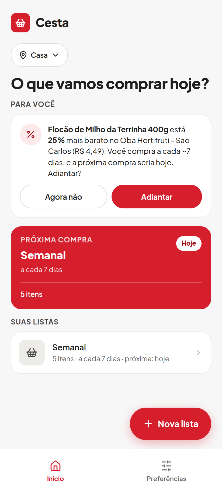 | 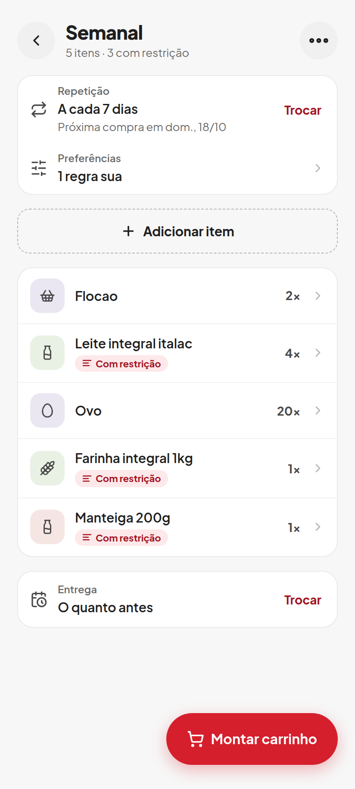 |
| **01 · Início.** Chip de endereço, a seção "Para você" com a sugestão de promoção, o cartão "Próxima compra" e as listas. "Nova lista" fica no botão flutuante. | **02 · Lista.** Repetição e preferências no topo, botão tracejado "Adicionar item", itens com a etiqueta "Com restrição", entrega e "Montar carrinho" no botão flutuante. |

### Item e preferências

| | |
|---|---|
| 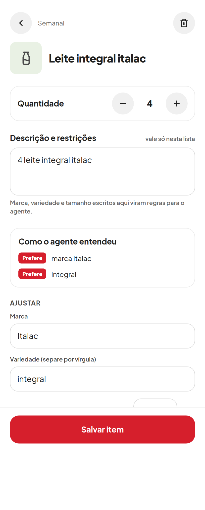 | 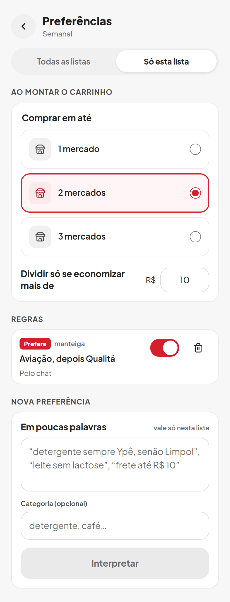 |
| **03 · Item.** Quantidade, descrição em texto livre, "Como o agente entendeu" com os selos e campos para ajustar. | **05 · Preferências da lista.** Controle de escopo, limite de mercados em cartões, valor mínimo para dividir, regras com origem e chave, e "Nova preferência". |

### Assistente

| | |
|---|---|
| 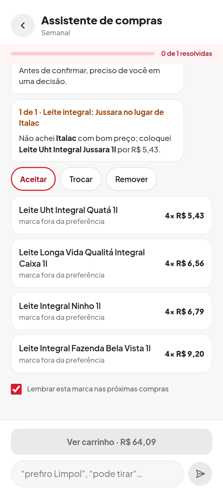 | 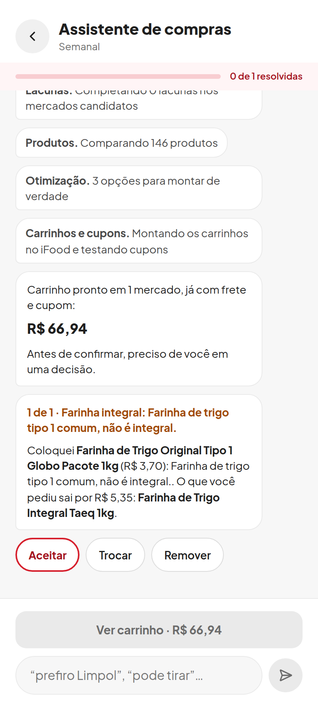 |
| **09 · Decisão.** Conflito numerado, respostas rápidas com a sugerida em destaque, alternativas com preço e "Lembrar esta marca". | **11 · Montagem e decisão.** Etapas narradas em balões, total pronto em destaque e o próximo conflito com a escolha aplicada. |
| 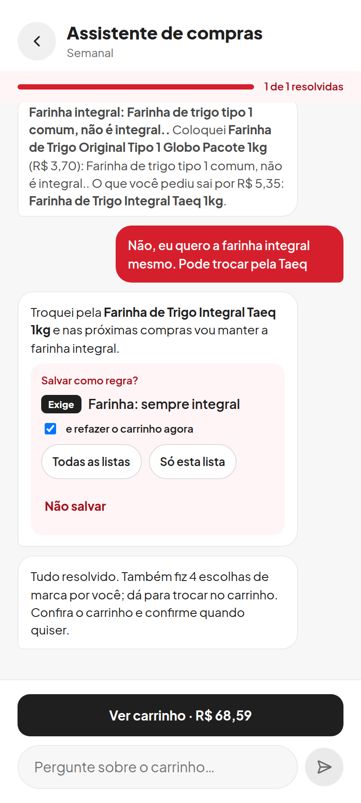 | 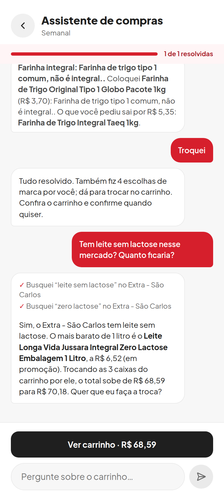 |
| **13 · Correção vira regra.** A mensagem do usuário em balão vermelho, a resposta do agente e o cartão "Salvar como regra?" com selo e escopo. | **14 · Pergunta aberta.** Passos do agente com marcas de verificação, a resposta com o produto em negrito e o impacto no total antes de trocar. |

### Confirmação

| | |
|---|---|
| 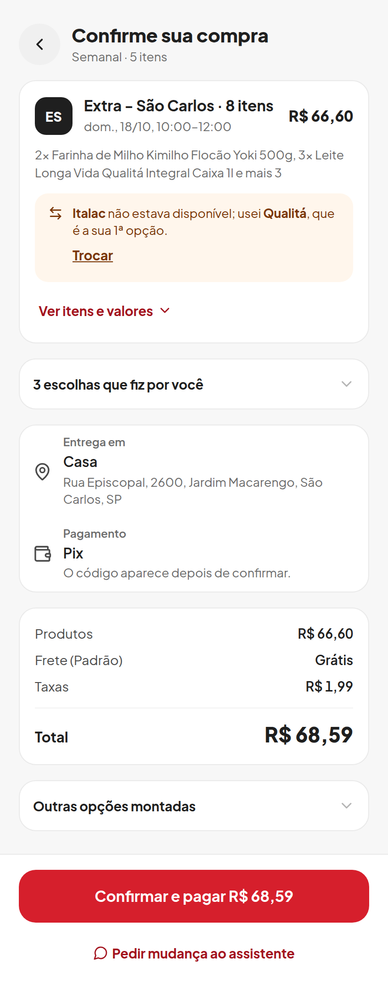 | 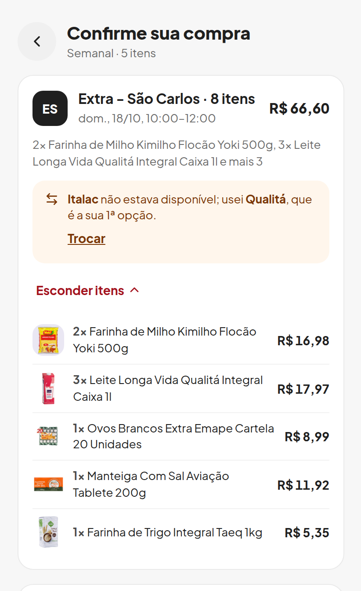 |
| **15 · Confirmar.** Cartão do mercado com horário e a substituição em âmbar, blocos recolhíveis, entrega e Pix, resumo de valores e o botão com o total. | **17 · Itens e valores.** O cartão do mercado expandido, com foto, quantidade e preço por produto. |
| 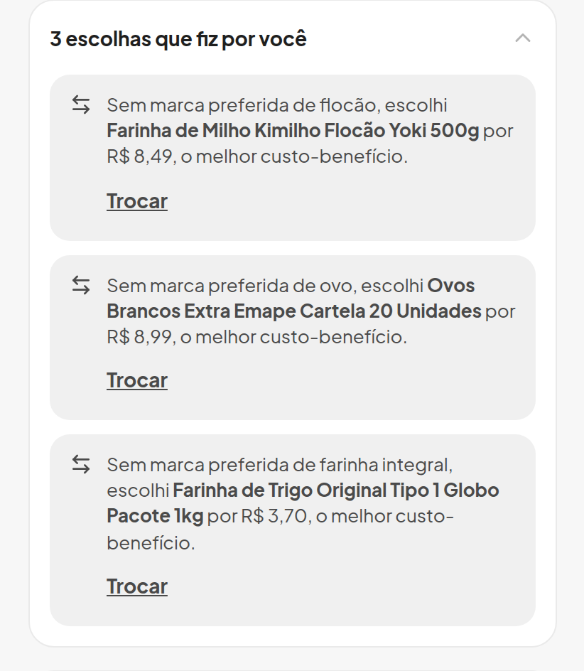 | |
| **18 · Escolhas do agente.** O bloco expandido, uma escolha por cartão cinza, com o motivo e "Trocar". | |
